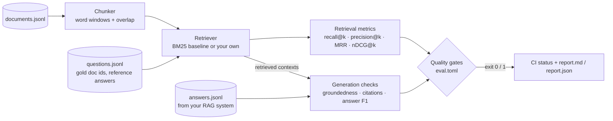

# rag-evaluation-pipeline

**Your RAG demo looked great. How do you know the next change did not make it worse?**

`rageval` turns retrieval-augmented generation quality into numbers that run in CI: did retrieval
find the right sources, is every answer sentence supported by what was retrieved, and did any
metric drop below the agreed threshold? It runs offline, has no runtime dependencies, and returns
the same result on every run.

[](../../actions/workflows/ci.yml)


## How it works



## What it measures

| Metric | Question it answers | Notes |
|---|---|---|
| `recall@k` | Did the top k results include the documents that hold the answer? | Document level: several chunks of one document count once |
| `precision@k` | How much of the top k was relevant? | |
| `mrr` | How high was the first relevant document? | |
| `ndcg@k` | Were relevant documents ranked near the top? | Binary relevance |
| `groundedness` | What share of answer sentences are supported by **one** retrieved context? | Unsupported sentences are listed for review |
| `citation_precision` | Did the answer cite chunks that were actually retrieved? | Catches invented citations |
| `answer_f1` | How close is the answer to the reference answer? | SQuAD-style token F1 |
| `answer_coverage` | Did the system answer every question? | |

A gate on a metric that could not be computed **fails**: missing data must not look like success.

## Try it

```bash
pip install .
rageval run --config eval.toml --out reports
```

The bundled sample is a small **synthetic** payments help-centre corpus (10 documents, 10
questions). One answer contains a planted unsupported claim, and the report flags it:

```text
| recall@3 | 1.000 | >= 0.90 | pass |
| mrr | 1.000 | >= 0.80 | pass |
| groundedness | 0.950 | >= 0.85 | pass |
...
## Unsupported answer sentences (review for hallucination)
- `q5`: Premium merchants get a 0.5 percent loyalty discount on all international volume.
```

Exit codes: `0` all gates passed, `1` a gate failed, `2` invalid input or configuration.

## Use it on your own system

1. Export your corpus as `documents.jsonl`: `{"id": "...", "title": "...", "text": "..."}`.
2. Write `questions.jsonl` with the documents that should be found:
   `{"id": "q1", "question": "...", "relevant_doc_ids": ["..."], "reference_answer": "..."}`.
3. Run your RAG system on the questions and save `answers.jsonl`:
   `{"question_id": "q1", "answer": "...", "cited_chunk_ids": ["doc#0"]}`.
4. Set thresholds in `eval.toml` from a baseline run, then add `rageval run` to CI.

To evaluate your production retriever instead of BM25, implement the `Retriever` protocol
(`search(query, k) -> list[Hit]`) and call `rageval.evaluate.evaluate` from Python.

## Design decisions

- **Deterministic first gate, model judge later.** Lexical checks are free, repeatable and
  explainable; model-based judges are a scheduled, calibrated second layer.
  See [ADR 0001](docs/adr/0001-lexical-metrics-as-the-first-gate.md).
- **Support must come from one context.** Words scattered across unrelated chunks do not count
  as evidence.
- **Negations are kept.** "not" and "no" are not stop words, so "never stored" and "not stored"
  are not treated as the same claim.
- **Zero runtime dependencies.** Standard library only, so it runs anywhere Python 3.11 runs and
  adds nothing to the supply chain. See [security and privacy notes](docs/security-and-privacy.md).

## Limitations

- Lexical groundedness misses paraphrases and can be fooled by an answer that reuses source words
  with a different meaning. Treat it as a screen, not proof.
- BM25 is a baseline for comparison, not a recommendation for production retrieval.
- The sample data is synthetic and tiny; thresholds must come from your own labelled set.

## Production checklist

- [ ] Evaluation set built from approved or synthetic data, versioned with the code
- [ ] At least 50–100 questions covering each document family and known failure cases
- [ ] Thresholds set from a baseline run and reviewed by the product owner
- [ ] Gate runs on every pull request that changes prompts, chunking, retrieval or models
- [ ] Reports retained as CI artifacts with access restricted to the data's classification
- [ ] Flagged sentences reviewed by a person; recurring flags turned into new test questions
- [ ] Scheduled model-based or human review to catch what lexical checks miss

## Tests

```bash
pip install -e ".[dev]"
ruff check . && pytest -q
```

28 tests cover the metrics against hand-computed values, BM25 ranking and tie-breaking,
chunking edge cases, gate behaviour and the CLI end to end. CI runs them on Python 3.11, 3.12
and 3.13, then runs the sample evaluation as a gate and uploads the report.

---

Author: [Rubbaite T. Hassain](https://tanvir.info.bd) ([LinkedIn](https://www.linkedin.com/in/rubbaite)) · Software Architect, Founder of [Datazo InfoTech](https://www.datazoinfotech.com.bd) · MIT License

Architecture, requirements and review by Rubbaite T. Hassain; implementation AI-assisted.
